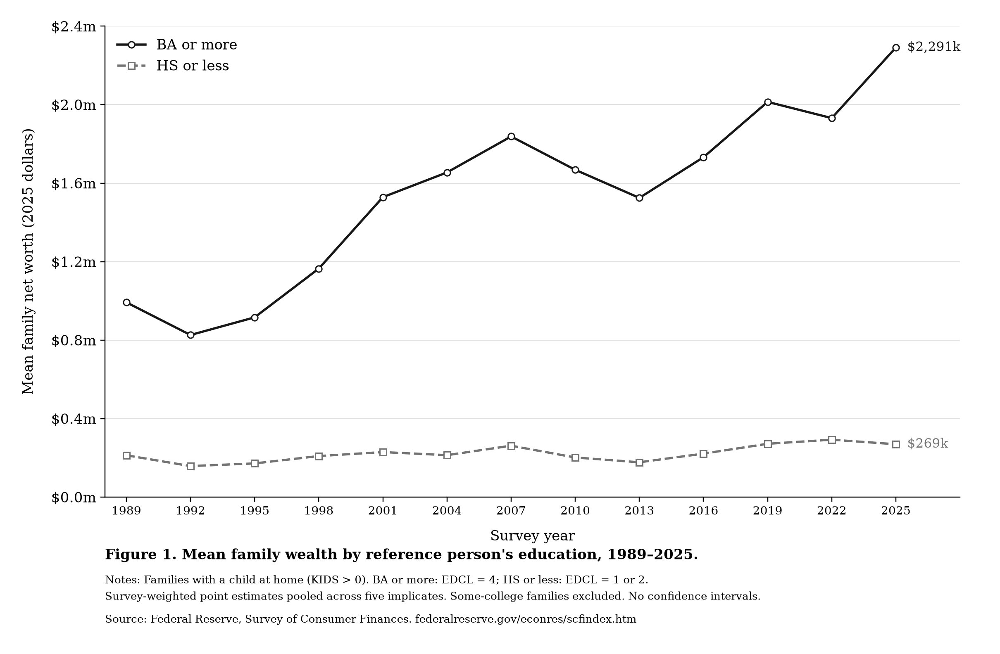

# Family wealth by education

POLISCI 158, Section 3 — Option B. This reproduces the workshop's [mean wealth figure](https://polisci158-2026.github.io/section-03/fig2-extended.png), using data downloaded directly from the Federal Reserve's [Survey of Consumer Finances](https://www.federalreserve.gov/econres/scfindex.htm), 1989–2025.



The figure includes families with a child at home (`KIDS > 0`), grouped by the reference person's education: bachelor's or more (`EDCL = 4`) versus high school or less (`EDCL = 1 or 2`). It uses weighted mean net worth and all five imputed records per family. The supplied weights already account for these records, and the data already use 2025 dollars.

The calculations match 130 published mean/median values in the Fed's historical Table 4 within rounding (largest difference: $4.99). A fresh download and rerun reproduced the same figure. In 2025, mean wealth is $2,291,089 versus $269,168; this is a descriptive gap, not a causal estimate. Confidence intervals are not calculated.

## Run

Requires Python 3.12+ and `curl`. The download script creates the local data files.

```sh
python3 -m venv .venv
source .venv/bin/activate
python -m pip install matplotlib==3.11.2 numpy==2.5.4 pandas==3.0.6 openpyxl==3.1.5
python get_data.py
python plot.py
```

AI-use note: Codex wrote the scripts and README, generated the figure, and checked the results.
